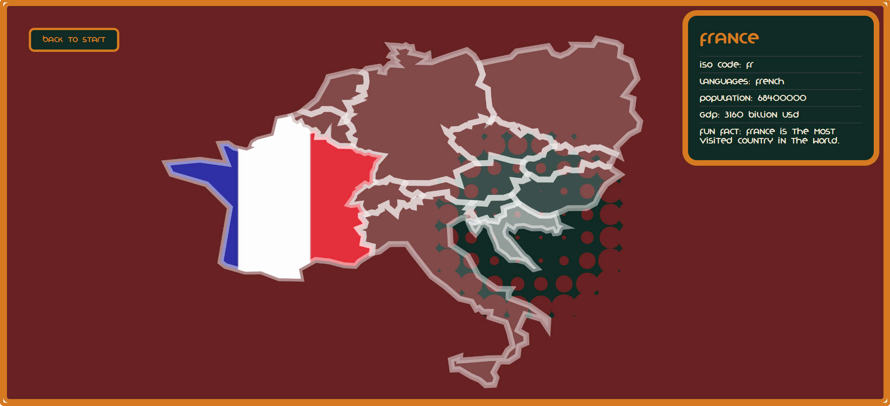
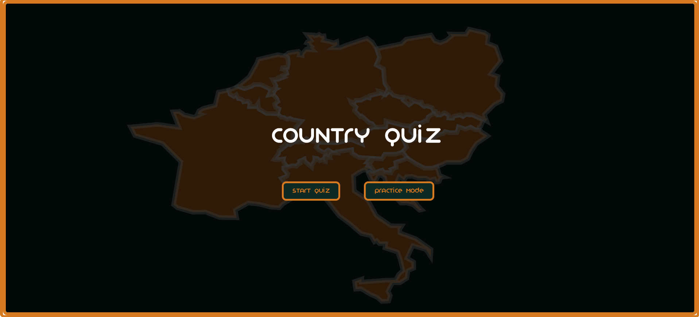
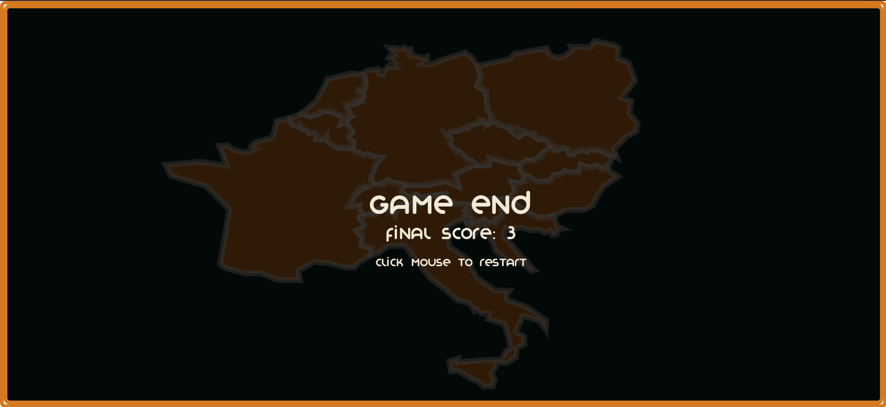
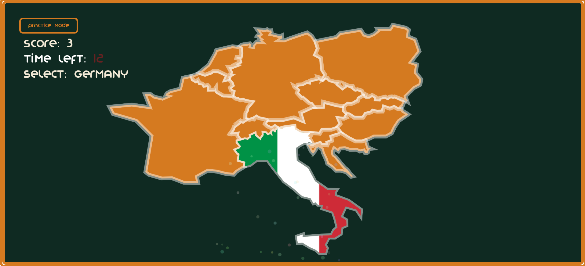

# Final Project — Country quiz


---

### The Project
My project is a quiz where you have to find the country on a map. There are to modes: Practice mode and play mode.


---

### Output






video :


---

### ✍️ Reflection

Reflection Prompt
Concept
My project is an interactive map, which is also a quiz. I initially wanted to do an interactive map of Europe where you can see different attributes like population, relief etc. but this turned out to be harder than expected so I tuned my map into a country quiz with also a practice mode, where you can look at the countries and see specific information about each country.
Interaction Logic
The system uses mainly the mouse, to click buttons, start the game, change mode and restart. 
Technical Structure
I have a data folder where my json file with the map data is, I used the coordinates and transformed them into pixels so the map of Europe can be displayed. In general, my project has states to switch between: start, play, practice, end. The majority of the logic is in extra functions, to for example draw the country shape or display the UI, so that draw is not overloaded and unstructured. I also added a class, it’s for the particles, so I can easily create them.
Behavior Over time
I implemented a timer, at the beginning you have a total of 15 seconds to find the right country, and it decreases for each country one second, so for the 2nd country to find you  only have 14s. 
Aesthetic Decisions
I implemented most of the styling in the style.css file, where I designed the html objects like buttons and my info panel. The rest like text I designed in the sketch itself. I added my own font to give it more character.
Iteration & Challenges
I struggled the most with the map itself because I have never worked with json input before, but I really wanted to. I mean after doing some research and finding instructions it was easier, but it took me a long time to really understand how to do it. I also changed my project because of the map, because if you want to display more information in each country it is a lot of work and more data you need to have, which I didn’t. Overall, I think it was a good idea, I now mixed new with the already learned programming skills.


---

<!-- ─────────────────────────────────────────────────────
     GOING FURTHER — want to document more? Try any of these:

     ### ✨ Features
     A short list of what your project does.
     - Responds to mouse position and velocity
     - Generates sound based on particle density

     ### 🔍 Code Structure
     How are your files organised?
     - `sketch.js` — main setup and draw loop
     - `Agent.js` — autonomous agent class
     - `assets/` — images and sounds

     ### 🛠️ Hardware (if applicable)
     List any physical components used.
     - Arduino Uno
     - Sensor type and model

     ### 🧩 Something I'm Proud Of
     A snippet, a decision, a moment where it all came together.
     ```js
     // your code here
     ```

     ### 🔗 References
     Tutorials, libraries, artworks, or research that informed your project.
     ───────────────────────────────────────────────────── -->
